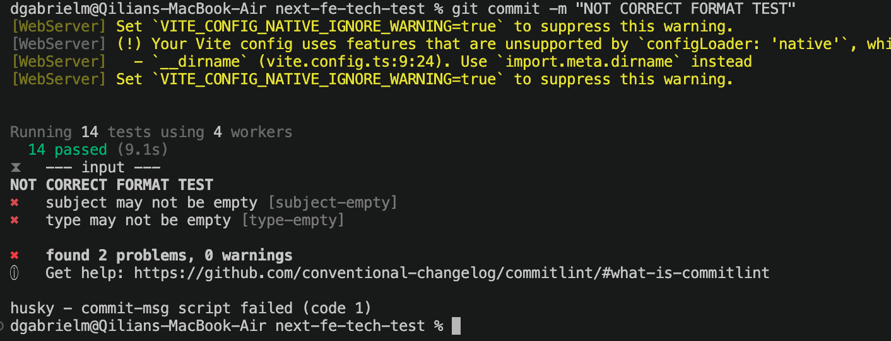
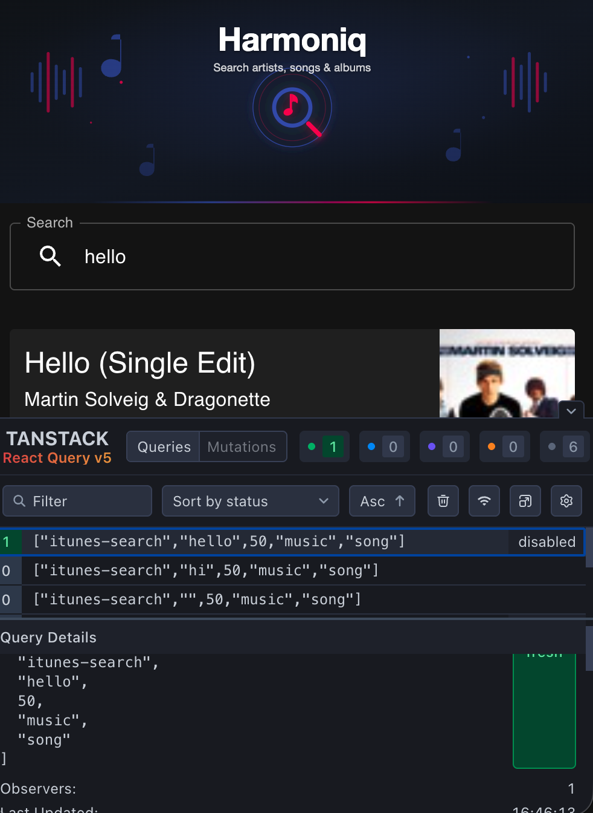
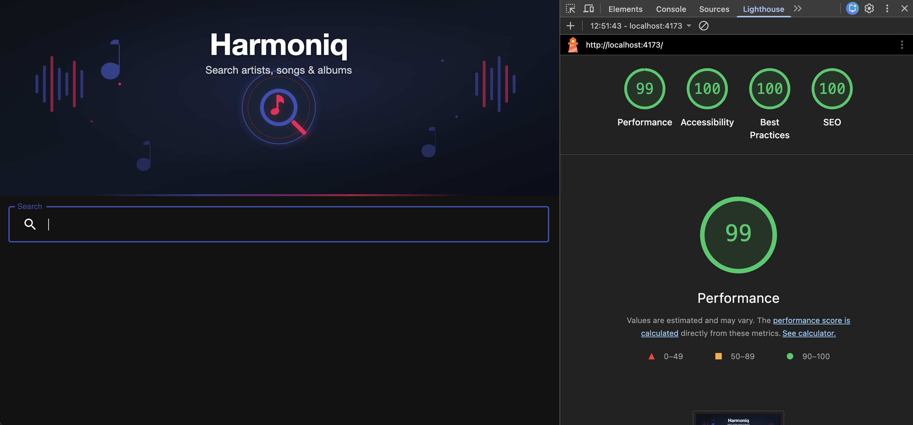
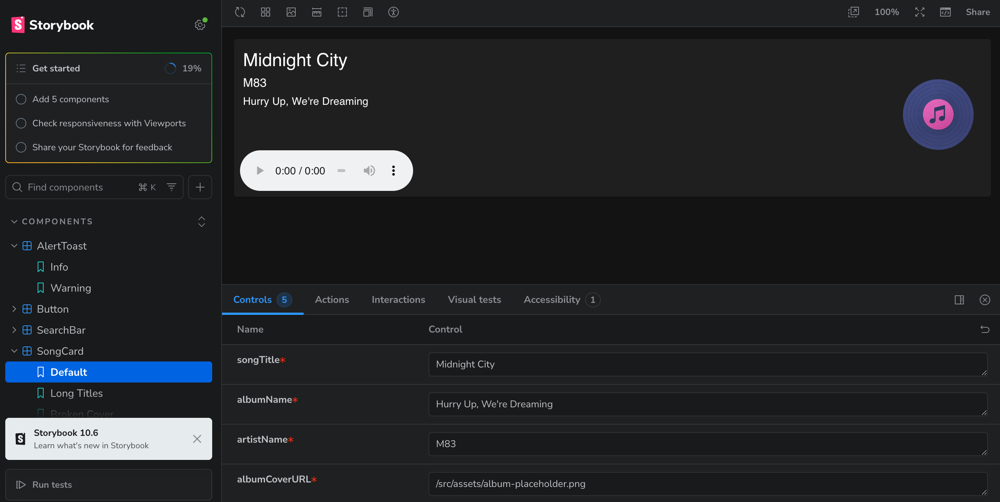
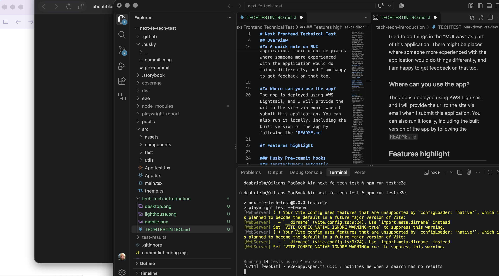
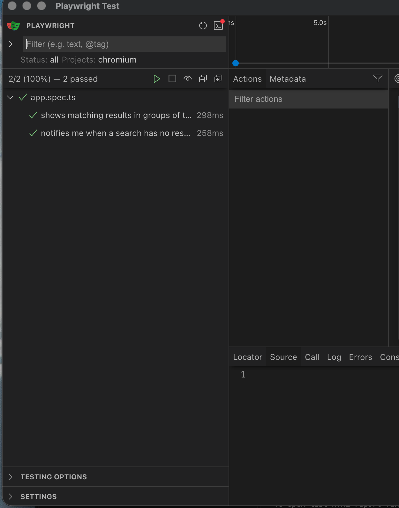
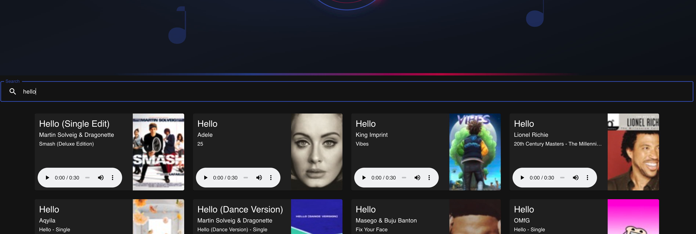
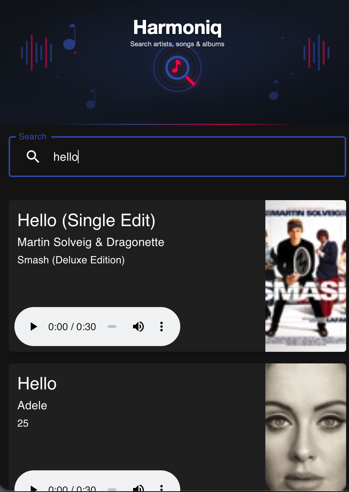

# Next Frontend Technical Test
Technical Test for NextPLC by Dario Mincioni.

## Overview
Hello, thank you for taking the time to consider my application. I've completed the task and added most of what I think should be included in a professional application. I have documented below things I have not included due to time constraints.

### does it meet the spec?
The app meets the acceptance criteria but deviates from the specification slightly in that it does not include Redux or an Express server. My reasoning is as follows: 

- An application like this (no complex state like session or user info) does not need advanced state management. I am also of the opinion that state management libraries should be used sparingly because they have a performance cost associated with them, and often a well structured application can avoid the need state management tools or heavy prop drilling. See https://kentcdodds.com/blog/application-state-management-with-react for one example. 
- TanstackQuery is also an excellent tool for managing state data called from an external API and includes response caching out of the box, so I've used that as my preferred library.
- I am of the opinion that in most cases you would not deploy a web application behind an express server simply to serve the static web files because there are cloud tools that scale automatically without the complexity of managing scaling resources for self-managed server. On AWS this could be S3, Route53 and CloudFront or the newer Amplify tool which uses those under the hood. The Azure equivalent might be: Azure Blob storage, Azure DNS and Azure Front Door.

However, please consider this to be a first draft, and if you would like to do a code review, I would be happy to make any changes and/or include these technologies.

### iTunes API limitations
The itunes API does not have a parameter for pagination, so I was unfortunately not able to implement real load-on-scroll - instead the load-on-scroll happens between the application and the DOM: 10 get added to the DOM at a time on scroll. In there way there is still a performance saving on the frontend, just not on the network payload.

### A quick note on MUI
I've not used MaterialUI before, but I have tried to do things in the "MUI way" as part of this application. There might be places where someone more experienced with the application would do things differently, and I am happy to get feedback on that too.

### Where can you use the app?
The app is deployed using AWS Amplify, and I will provide the url to the site via email when I submit this application. You can also run it locally, including the built version of the app by following the `README.md`

## Features highlight

### Husky Pre-commit hooks
Husky checks that all tests and formatting passes before allowing the developer to commit code to the branch. This happens locally and can be overridden if necessary. In the example, see how the incorrectly formatted commit message fails the commit even though the main tests have passed: 

For more details on what Husky checks, see the README.md

### TanstackQuery automatic cacheing
TanstackQuery provides automatic caching as discussed above, and also has excellent state debugging tools which are configured to only appear on the dev server. Perfect for development:

### Nearly perfect Lighthouse scores
I have written this application with accessibility and performance in mind, which is reflected in the Lighthouse scores:

Note: this is on the built version of the app, running locally, but should reflect reasonably similarly to production.

### Storybook component testing
I have added [Storybook](https://storybook.js.org/) to the codebase to test components in isolation. This tool lets you play with the properties of a component for testing in different contexts. In the example you can see the song card component which is used to display song results and it uses the fallback image which occurs in the case that no image is returned by the API:

### Playwright E2E testing CI/CD
I have written [playwright](https://playwright.dev/) tests which cover the two A/C provided in the task specification:

### responsive design
I have made sure the app will work and look reasonable at most screen sizes:

Desktop:

Mobile:

## What I would add or change given more time
I wrote this application to be as maintainable, flexible and performant as I would write any professional web application. However, as this is a technical test, I have not added every little thing I would like to add, fix or refactor that I would for an application built to actually be used in production - so I'll list them here:

- CI/CD:
    - automated changelog generation based on the commit convention enforced using https://github.com/TriPSs/conventional-changelog-action or similar.
    - automated version bumping.
    - automated deployment to server (if using service other than AWS Amplify or Vercel etc which watches your repository and does this automatically).
    - Add branch protection rules, enforcing PRs from another branch into main, and certain other standards like minimum 2 approvals etc (depends on what works for the team).
    - run full test suite before allowing merging of PRs into live branches.
    - Add dependabot to github repo to automatically check which libraries need to be updated for security purposed.
    - Add protected branches representing enviornments for dev, staging, prod (and have these deploy to their own environments for a more complete SDLC).
- Application:
    - add a more nicely designed loading state.
    - comprehensive check on copy.
    - comprehensive error handling built into the api client and more clearly defined behaviour for alerting the user when different types of errors are sent from the API (and more complete testing of this).
    - routing useing react-router (or conversion to a NextJS application if SSR/SSG is required). I did not feel like it was necessary to build in routing for an application that has one user journey, but would of course for any application I know is going to grow.
    - get to 100% unit test coverage (currently the whole application IS covered by unit test and e2e tests but there is technically less than 100% unit test coverage).
    - get Lighthouse performance score to 100 - it's currently on 99 and there are some interesting recommendations on the report which I would like to research and understand so I can address or make a conscious decision to disregard.
- Developer Experience
    - restructure application to have a 'models' folder which holds TS definitions for requests and expected responses (assuming the application has more than one API endpoint to call).
    - create easy-to-use mocking setup for local testing. (I've made one of these in the past by intercepting client calls and matching endpoints to mock data which works really nicely when you need to develop a frontend before an API has been built).
    - would possibly add snapshot testing to everything as cheap way of determining when changing one thing in the application might inadvertantly affect another, and highlight this to the developer.
    - slight structure changes to components folder structure. One folder per component for better readability and possibly a lib folder if creating small single-responsibility UI components from scratch (i.e. if not using MUI).

## AI Usage statement
I have designed and built this application using my learnings and understanding gained from over 8 years of experience in the tech industry, however I have used an LLM to assist with certain parts of the development, which I will make clear here. 

I have used LLMs to:

- assist in searching the internet and tools' documentations to find out how various tools and concepts work.
- generate images to use in the design of the application (header, favicon and album cover fallback image are all generated).
- help to debug a small number of issues I found in order to speed up development.
- generate first draft of certain test cases for my review to assist in speed of development.
- to assist in the writing of the README.md (but not this document).

I consider this code to be wholly my own work and my LLM usage to be limited to boiler plate or non-coding tasks and has not been used in any technical design decisions.
